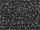
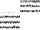
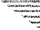
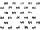

# Making Maps

A guide to building levels in [Tiled](https://www.mapeditor.org/) for Dungeon Mode Kit.

---

## Getting Started

1. Download and install [Tiled](https://www.mapeditor.org/)
2. Open the project file: `tiled/dungeonkit.tiled-project` — the tileset loads automatically
3. Maps must be saved as `map.tmj` (exact filename) inside `prototypes/{name}/`

### Copying an Existing Map

The fastest way to start. Good starter templates:

- `prototypes/arena/` — simplest hand-built map
- `prototypes/catacombs/` — wildcard-based procedural map

Steps:

1. Copy the prototype folder and rename it
2. Open the `map.tmj` in Tiled and edit it
3. Update `prototype.json` with a new name, description, etc.

### Creating a Map from Scratch

1. **File > New Map**: Orthogonal, CSV encoding, tile size 40×30 px, set your desired width/height in tiles
2. **Add the tileset**: Map > Add External Tileset → select `tiled/static-tiles.tsj`
3. **Create the 6 layers** listed below (names must be exact)
4. **Save as** `prototypes/your_level/map.tmj`
5. You also need a `prototype.json` in the same folder — see the [README](../README.md) for all fields

---

## The Six Layers

Create these layers in Tiled from bottom to top:

| Layer | Type | Purpose |
|-------|------|---------|
| `background` | Tile | Void/decoration behind everything |
| `floor` | Tile | Walkable terrain — any non-zero tile here is walkable |
| `wildcards` | Tile | Procedural generation markers (see next section) |
| `actors` | Object | Spawn points for actors |
| `items` | Object | Spawn points for items |
| `landmarks` | Object | Walk-over decorations |

Some existing maps include a `ui` tile layer — the engine ignores it completely. You can omit it.

### Layer Details

**background** — Fill entirely with  `FULL_BLOCK` (tile 217, solid black). The engine clears background behind floor tiles automatically, so this just fills the void. You can also paint other decorative tiles here for effect.

**floor** — Paint walkable areas.  `FLOOR` (tile 158) is the standard floor tile, but any tiles can be used for decorative effect. Leave cells empty (null or tile 0) for impassable void.

**wildcards** — Paint regions that the engine fills with procedural content at runtime. See [Wildcard Tiles](#wildcard-tiles-generative-fills) below.

**actors** — Place point objects. Set each object's `type` to an actor ID from `data/actors.json` (e.g. `player`, `skeleton`, `down_stairway`). The `player` actor must appear here.

**items** — Place point objects. Set each object's `type` to an item ID from `data/items.json` (e.g. `torch`, `sword`, `crown`).

**landmarks** — Place point objects for walk-over decorations:

| Tiled Field | Purpose |
|-------------|---------|
| `type` / `class` | Tile name from `data/static-tiles.json` (e.g. `SKULL`) |
| `name` | Optional display name |
| `walk_description` (custom property) | Message shown when the player steps on it |
| `tint` (custom property) | Hex color string (e.g. `#FF8800`) |

---

## Wildcard Tiles (Generative Fills)

Paint a region on the `wildcards` layer and the engine fills it with procedural content at runtime. The painted region defines the boundary — hand-painted floor tiles outside the region are preserved.

### Generator Reference

| Generator | Tile | Tile ID | What It Creates |
|-----------|------|---------|-----------------|
| Dungeon |  | 16 | Walled rooms + corridors + doors |
| Cave |  | 10 | Organic cave shapes |
| Infernal |  | 230 | Cave + lava pools |
| Maze |  | 210 | Perfect maze corridors |
| Room |  | 143 | Single walled room |
| Item spawn |  | 12 | Random items from `random_items` config |
| Actor spawn |  | 3 | Random actors from `random_actors` config |

Tile 16 (`PRISON_WINDOW`) is the recommended dungeon wildcard. Tiles 9 (`OPAQUE_INVERSE_DIAMOND_SUITE`) and 152 (`OPAQUE_PRISON_WINDOW`) also work — all three generate the same dungeon layout. Tile 144 (`INVERTED_CHECKER_BOARD`) is an alternate room tile.

### Tips

- Paint a large contiguous region for best results
- You can combine multiple wildcard types on the same map
- Hand-painted floor tiles are preserved — wildcards only fill their own region
- See `prototypes/catacombs/map.tmj` (dungeon) and `prototypes/mine/map.tmj` (cave) for examples

---

## Painting Actors on the Wildcards Layer

Some actors have a `paint_tile` attribute — paint their tile on the `wildcards` layer to spawn them in bulk. This is how you draw walls, water, and lava by hand.

| Actor | Tile | Tile ID | Tile Name | Use For |
|-------|------|---------|-----------|---------|
| `wall` |  | 132 | `WALL_TOP` | Standard walls |
| `rock_wall` |  | 178 | `DARK_SHADE` | Natural rock walls |
| `wall-bottom-left-corner` |  | 156 | `LIGHT_SHADE_UPPER_RIGHT_TRIANGLE` | Wall corners |
| `wall-bottom-right-corner` |  | 155 | `LIGHT_SHADE_UPPER_LEFT_TRIANGLE` | Wall corners |
| `wall-top-right-corner` |  | 134 | `LIGHT_SHADE_LOWER_LEFT_TRIANGLE` | Wall corners |
| `wall-top-left-corner` |  | 157 | `LIGHT_SHADE_LOWER_RIGHT_TRIANGLE` | Wall corners |
| `water` |  | 147 | `IMPERFECT_DOTTED_LIGHT_SHADE` | Water terrain |
| `sewage` |  | 135 | `OPAQUE_DOTTED_LIGHT_SHADE` | Toxic water |
| `lava` |  | 20 | `DOUBLE_EXCLAMATION_MARK` | Damaging magma |
| `fire` |  | 5 | `BLACK_DIAMOND_SUITE` | Spreading fire |

Deep water and deep sewage are spawned automatically by the engine wherever large contiguous regions of `water` or `sewage` exist — you don't need a separate wildcard for them.

---

## Map Size and Scrolling

- **Map dimensions**: set in Tiled via Map > Map Properties as width/height in tiles
- **Viewport**: set in `prototype.json` under `mechanics.viewport_width` / `mechanics.viewport_height`
- When viewport < map size → the camera scrolls to follow the player
- When viewport >= map size (or unset) → the entire map is visible with no scrolling
- For procedural-only maps (no .tmj), set `map_generator.options.map_width` / `map_height` in prototype.json

Example:

```json
"mechanics": {
  "viewport_width": 30,
  "viewport_height": 30
}
```

---

## Connecting Levels with Stairways

Link levels together using `next_level` and `previous_level` in `prototype.json`:

```json
{
  "next_level": "catacombs",
  "previous_level": "default"
}
```

Place stairway actors on the `actors` object layer:

| Actor | Purpose |
|-------|---------|
| `down_stairway` | Where the player arrives from the level above |
| `up_stairway` | Exit to the level above |
| `locked_down_stairway` | Sealed until `win_conditions` are met |
| `locked_up_stairway` | Sealed until `win_conditions` are met |

Typical pattern: Level A sets `"next_level": "level_b"`, Level B sets `"previous_level": "level_a"`. The player enters at the matching stairway direction.

If you don't place an `up_stairway`, the engine auto-places one on a random walkable tile.

---

## Tips

- **Layer names must be exact** — the engine matches on strings
- **Map file must be named `map.tmj`** — no other filename works
- If both `map.tmj` and `map_generator` exist in a prototype, the .tmj takes priority
- Serve locally with `python3 -m http.server`, then load with `?prototype=your_level`
- If a stairway appears in an unexpected spot, you probably forgot to place one — the engine auto-places a missing `up_stairway`
- Any actor with a `paint_tile` attribute can be painted on the wildcards layer — check `data/actors.json` for the full list
