# Wildcard Tiles

A complete reference for the tiles you paint on the `wildcards` layer in [Tiled](https://www.mapeditor.org/) — which tile spawns which actor, and which tiles trigger procedural generators. For the full map-editing workflow, see [MAP.md](MAP.md).

> **Printable version:** [TILED_KEY.pdf](TILED_KEY.pdf) is a laid-out, single-file visual key of the same content (dark background so white-pixel tiles stay visible). Regenerate it with `/Users/wileywiggins/Development/libuse/tiledKey.py` (see [Regenerating tile images](#regenerating-tile-images)).

---

## How It Works

Paint a tile on the `wildcards` tile layer and the engine resolves it at runtime to one of two things:

- **An actor** — if the tile matches an actor's `paint_tile` attribute in `data/actors.json`, that actor is spawned across the painted region. This is how walls, water, lava, and other terrain are drawn in bulk.
- **A procedural generator** — a handful of tiles are hardcoded generator markers (dungeon, cave, maze, etc.); the engine fills the painted region with generated content.

Tiles are identified by a numeric **tile ID**. For a tile at column `col`, row `row` in the tileset (23 columns wide), the ID is:

```
tileId = row * 23 + col + 1
```

This matches the gid Tiled stores in the `wildcards` layer. Actor matching happens in `architect/tiled.js` (`getActorWildcardType` → `getTileIdByName`); builtin generators live in `architect/tiled.js` `builtinWildcards`. The name→coordinate table is `data/static-tiles.json`.

---

## Actor Wildcard Tiles

Each actor below defines a `paint_tile` in `data/actors.json`. Paint that tile on the `wildcards` layer to spawn the actor in bulk.

### Architecture

| Actor | Tile | Tile ID | Tile Name | Use For |
|-------|------|---------|-----------|---------|
| `wall` | 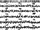 | 132 | `WALL_TOP` | Standard walls |
| `brick_wall` | 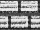 | 255 | `BRICK_WALL` | Masonry walls |
| `rock_wall` | 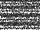 | 178 | `DARK_SHADE` | Natural rock walls (mineable) |
| `fortification` |  | 249 | `BALLOT_BOX` | See-through battlements |
| `pedestal` | 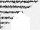 | | `WHITE_DOOR_TOP`| locked plinth for items |

### Terrain & Liquids

| Actor | Tile | Tile ID | Tile Name | Use For |
|-------|------|---------|-----------|---------|
| `water` | 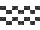 | 389 | `WATER` | Water terrain |
| `sewage` | 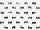 | 135 | `OPAQUE_DOTTED_LIGHT_SHADE` | Toxic water |
| `lava` |  | 20 | `DOUBLE_EXCLAMATION_MARK` | Damaging magma |
| `quicksand` |  | 167 | `MEDIUM_SHADE_LOWER_ONE_HALF_BLOCK` | Sinking pits |
| `tree` |  | 31 | `UPWARD_POINTING_TRIANGLE` | Trees (flammable) |
| `fungus` | 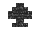 | 7 | `BLACK_SPADE_SUITE` | Glowing fungus |


Deep water and deep sewage are spawned automatically wherever large contiguous regions of `water` or `sewage` exist — you don't need a separate wildcard for them.

### Hazards

| Actor | Tile | Tile ID | Tile Name | Use For |
|-------|------|---------|-----------|---------|
| `fire` | 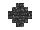 | 5 | `BLACK_DIAMOND_SUITE` | Spreading fire |
| `collapsing_floor` | 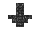 | 26 | `DOWNWARDS_ARROW` | Floor that collapses when stepped on |

### Fixtures

| Actor | Tile | Tile ID | Tile Name | Use For |
|-------|------|---------|-----------|---------|
| `pedestal` |  | 371 | `WHITE_DOOR_TOP` | Solid plinth that displays the item it holds (a key by default) |

Unlike the terrain actors above, a pedestal is usually painted as single tiles rather than
a filled region — one tile, one pedestal.

Paint the floor underneath it on the floor layer, as you would for any actor wildcard. A
tile painted with an actor wildcard is not part of any generator region around it, so
dotting one inside a painted generator region leaves it standing over void — the generator
skips the tile it does not claim.

---

## Generator Wildcard Tiles

These tiles are hardcoded generator markers. Paint a contiguous region and the engine fills it with procedural content — the painted region defines the boundary, and hand-painted floor tiles outside it are preserved.

| Generator | Tile | Tile ID | Tile Name | What It Creates |
|-----------|------|---------|-----------|-----------------|
| Digger region | 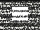 | 16 | `PRISON_WINDOW` | Walled rooms + corridors + doors (ROT.js Digger) |
| Cave | 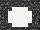 | 10 | `INVERSE_BULLET` | Organic cave shapes |
| Infernal | 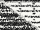 | 230 | `OPAQUE_LIGHT_SHADE_UPPER_RIGHT_TRIANGLE_AND_OPAQUE_DARK_SHADE_BOTTOM_LEFT_TRIANGLE` | Cave + lava pools |
| Maze |  | 210 | `DESERET_CAPITAL_LETTER_ES` | Perfect maze corridors |
| Room |  | 143 | `INVERTED_CHECKER_BOARD` | Single walled room |
| Dungeon | 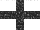 | 197 | `BOX_VERTICAL_HORIZONTAL` | Rooms + corridors + loops + secret doors — the main generator |
| Uniform |  | 142 | `BLACK_SQUARE` | Evenly distributed rooms |
| Rogue |  | 36 | `NUMBER_SIGN` | Classic grid of rooms (needs a region ~22 tiles a side) |
| Divided maze | 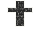 | 232 | `CROSS` | Recursive-division maze |
| Icey maze | 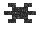 | 43 | `ASTERISK` | Maze with regularity control |
| Arena | 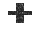 | 44 | `PLUS_SIGN` | Open walled box |
| Item spawn | 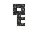 | 12 | `BLACK_KEY` | Random items from `random_items` config |
| Actor spawn | 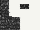 | 3 | `OPAQUE_WHITE_SMILING_FACE` | Random actors from `random_actors` config |

Every map generator has a wildcard tile. **Cave** (10) is the `cellular` generator and
**Maze** (210) is `eller_maze` — both keep older, generic names. Region generators wall
whatever they leave solid (honoring `wall_types`); Maze is the one exception and carves
floor only.

There is no abyss wildcard: to make a hole, leave the area unpainted on the floor layer.
Randomly-placed chasms are the `abyss` option on `map_generator`, not a painted region.

Tile 16 (`PRISON_WINDOW`) is the recommended `digger_region` wildcard. Tiles 9 (`OPAQUE_INVERSE_DIAMOND_SUITE`) and 152 (`OPAQUE_PRISON_WINDOW`) also generate the same layout. Tile 144 (`CHECKER_BOARD`) is an alternate room tile. Note this is distinct from the `dungeon` wildcard (197), which is the rooms-and-corridors generator.

---

## Regenerating Tile Images

The per-tile images above are generated from the spritesheet, not committed to git. If `assets/images/` is missing or a tile image doesn't render, regenerate them:

```
python3 scripts/slice-tiles.py
```

This slices `assets/sprites/static-tiles.png` into `assets/images/<TILE_NAME>.png` using the coordinates in `data/static-tiles.json` (requires Python + Pillow).

---

## Keeping This Doc Current

The data here is derived from three sources — re-derive if any of them change:

- `data/actors.json` — the `attributes.paint_tile` on each actor
- `data/static-tiles.json` — the tile name → `[col, row]` table
- `architect/tiled.js` — the `builtinWildcards` generator map in `getWildcardType`
