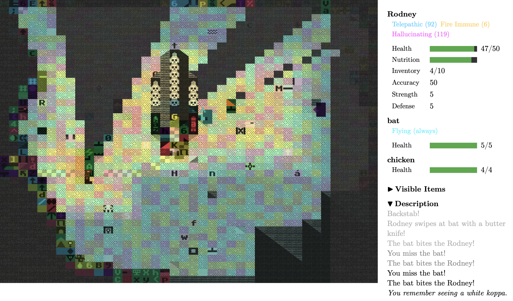
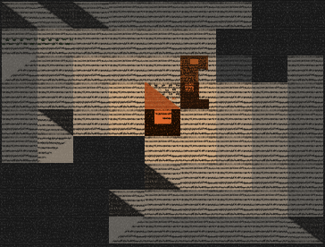

---

date: 2026-08-25
author: Wiley Wiggins
project: "Dungeon Mode Kit"
---

# What is unseen and what is unkown

The Dungeon Mode in my mind is focused on what is unseen and what is unkown, and this is happening at many levels. Visual specificity is part of the experiment of DMK, starting with this quote from *Dungeon Hacks*:

> With each new element Toy and Wichman wrote into Rogue, the game became more and more absorbing. Rather than reveal the entire dungeon map when players set foot in a new level, the game showed only their immediate surroundings. Moving in any direction revealed more of the map—and the creatures lying in wait. The graphics were primitive, but the thrill and apprehension of exploring uncharted terrain, combined with the pseudo-intelligent behavior of the monsters and the permanency of death, drew players deeper into the fantasy.  "We [printed] descriptions as things happened to you, and we had various monsters that we created, and potions, and things like that," Wichman remembered. "It was interesting that we did end up having an atmosphere even though all you're looking at is letters and symbols. We got drawn into the world, and you would imagine yourself in the world. You'd see a letter 'T' on the screen, and it would startle you because you knew it was a troll."
(Craddock. 2015)

From *Framing uncertainty: computer game epistemologies*:

> At the beginning there is the image (not the word!) as a first distancing between mind and world, the basic condition for differentiations between illusion and truth, map and territory. But this sequence is not to be understood as hierarchical. Images are not 'weaker' than symbols, names or notions (that would be blatant Platonism), they are just the first way of distancing from reality. Images come first because, for \[Hans\] Blumenberg, humans are defined as 'emphatically visible beings' and it is because of this that the visual sense plays such a primary role in human evolution. (Rautzenberg 2020, 132)

The DMK tileset intentionally combines image blocks with symbol blocks and gives them all semantic names, acting more like a characterset than a modern spritesheet. I'm interested in how these elements can be combined and changed in that combination.

Beyond visual specificity we are also concerned here with light and dark, and what is known and unknown, as when darkness, field of view and fog of war were introduced into dungeon games. I talk sometimes about my very first dungeon game experience, which wasn't a roguelike, but rather the TI-994a version of *Hunt the Wumpus*. A guessing game about drawing a map of places visited and using traces to guess at what lies in the blank "unknown" areas.

This sprint I polished up some mechanics related to vision and epistemology with the eel as a test case. The eel is inherited pretty directly from Brogue with some adjustments. An eel underwater isn't invisible (actors like ghasts have a visible: false attribute)— it's concealed by a medium, and that's a different fact with different rules. A isConcealedBySubmersion returned bool stays distinct from real invisibility which allows the player to also submerge and see the eel, but only in the same body of water. Two viewers in separate ponds still can't see each other. "Connected" runs through any liquid, shallow or deep, so a lake pinched to a shallow ford is still one body — pools get labelled by an 8-way flood fill.

Concealment is derived, not applied, it comes from isSubmerged on both sides rather than being set as a state, "so it can never go stale."

Submerging turned out to be two different concerns that I had been treating as one.
I had existing code that makes any two-tiled actor one tile, the top texture moves down into the base slot to simulate lowering into the pool. *Being hidden* underwater is the concealment predicate, and it's opt-in per creature with conceals_when_submerged: the designer picks what the water hides, an eel and not a wading ogre. Now the eel has no top tile at all (its top is BLANK), so it has no head to lower and the first mechanism does nothing for it; only the second one hides it. Once submerged, just the base tile reads through the surface — top, side and any equipment sitting above the base go dark, while equipment riding the base tile still shows.

There are also degrees of not-quite-seeing now rather than a single boolean. A telepathic viewer senses a sentient creature's body at 0.35 alpha wherever it is, submerged or not, so you can know something is there without seeing what it is. And there's a rule to never fade out a player-controlled actor's sprite as a "hidden" signal — fog of war is about what you're looking at, self-invisibility and telepathy are the times I use the translucent tile effect.

Like the visibility of the eel's tile, the player character's knowledge of its name changes (you can get bit by a hidden submerged thing, which is described thus). This is in the same vein as identification-aware item names. It's the player character knowledge of the world (distinct from the player's knowledge of the world!)

Writing all of this down made me split the whole business in two: sight (is it drawn) and knowledge (is it understood). DMK also already has known and unknown items with greeked or color/material names until they are identified through use, which is a pretty standard roguelike mechanic. Unkown names are randomly assigned but *stable* for the session, which is what makes them learnable rather than merely arbitrary; a cloudy potion is the same cloudy potion all run.

In a game like Brogue, being touched by the Toad enemy (or drinking a hallucination potion) causes a player state that continually shifts the identity of every enemy, *through a list of all possible enemies*. This includes enemies that the player character has never encountered. DMK goes one step further, its hallucination state shifts every individual actor tile continuously through the entire catalog of tiles, with the individual tile names as their hover descriptions.  It's interesting to imagine what both hallucination states tell us about each game system. Either hallucinations are some kind of state of gnosis in these worlds or both player characters have innate knowledge of these things. Brogue's player character has learned about all the monsters in the dungeon (and items) and this is why they have a catalog of things to tick off. The DMK player may know about all the items in a specific prototype (but prototypes can have any number of arbitrarily added items!) but their main point of reference for the world is the character set (which I sometimes call Libuše). Everything dissolves into that, the building blocks of that world. One of the few faults I can find with Brogue (which is an almost perfect game in my opinion) is that there are a few "bad" items that don't have some sort of value that can be found. The hallucination potion is one of them, so I have added a couple of secret beneficial uses for it that I hope will be discovered.

This sprint as given me an idea for the first small prototype that focuses on this subject— a brazier casts light and also blocks vision. Moving around it, a player actor with no torch has both a line-of-sight dead zone beyond the brazier and a shadow cast behind the player by the brazier's light, and the two 'shadows' mirror one another. One is a shadow of "unknowing," although that shadow is filled with a memory of another perspective.

I've added a bunch of related tables in a new document called [/docs/EPISTEMOLOGY.md](EPISTEMOLOGY.md)
